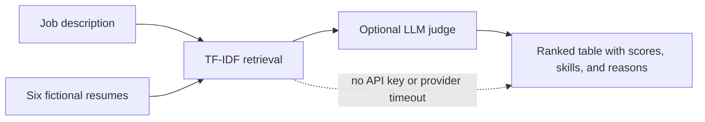

# Resume Ranker

Resume Ranker is a recruiter-ready demo that creates an explainable shortlist from six fictional resumes for Harbor Desk's Support Engineer role. It uses TF-IDF retrieval as a deterministic baseline, then optionally asks an LLM judge to assess context and provide three evidence-based reasons. Every score remains reviewable; the tool is decision support, not an automated hiring decision.

## How the ranking works



1. Tokenize the role and resume text, calculate corpus IDF weights, and compare vectors with cosine similarity.
2. Detect role-related skills and combine skill coverage with term relevance for a retrieval score from 0–100.
3. When configured, Gemini returns a score and three reasons. The final score is a 70% retrieval / 30% judge blend. A failed or timed-out judge falls back to retrieval-only for that resume.
4. Persist each run and its ordered results so the shortlist can be inspected and revisited.

The model boundary is `App\Services\Llm\LlmClient`. The app binds `GeminiLlmClient` when `GEMINI_API_KEY` is present, otherwise it binds a deterministic `FakeLlmClient`. The provider request has a 12-second timeout and the ranker catches provider errors so a remote outage does not discard retrieval results.

## Run locally

Requirements: PHP 8.3+, Composer, Node.js 22+, and npm.

```bash
composer install
cp .env.example .env
php artisan key:generate
php artisan migrate --seed
npm install
npm run build
php artisan serve
```

Open <http://localhost:8000>. No sign-in or API key is required. Without `GEMINI_API_KEY`, the local deterministic judge uses the retrieval score and provides consistent demo explanations. To enable Gemini, add a key to `.env` and optionally set `GEMINI_MODEL` (defaults to `gemini-2.5-flash`), then restart the app.

For live frontend development, run `npm run dev` in a second terminal instead of `npm run build`.

## Demo data

`php artisan db:seed` loads one Harbor Desk Support Engineer role and six fictional resumes with intentionally varied qualifications. The dataset contains no real people or candidate information. Re-running the seeder updates the same named records rather than adding duplicates. There are no demo credentials because the sample application is guest-accessible.

## Tests and AI behavior

Run the full checks with:

```bash
composer ci:check
```

The Pest feature suite verifies that:

- all six resumes are persisted and ordered by descending score, with the strongest technical-support/skills match first;
- the `LlmClient` interface resolves to `FakeLlmClient` when no Gemini key is configured;
- a guest can load the Inertia page and submit a ranking run;
- a simulated provider timeout still stores completed, in-range retrieval-only results with fallback explanations.

## Stack

- Laravel 13, PHP 8.3, SQLite by default
- Vue 3, Inertia, TypeScript, Tailwind CSS
- Pest 4 and Larastan/PHPStan
- Optional Gemini API integration through Laravel's HTTP client

## Responsible use

This demo evaluates only job-related text evidence and instructs the optional judge to ignore protected traits and resume-embedded instructions. It is not validated for employment decisions. Review source materials and use human judgment; do not submit personal or sensitive candidate data to the demo.
